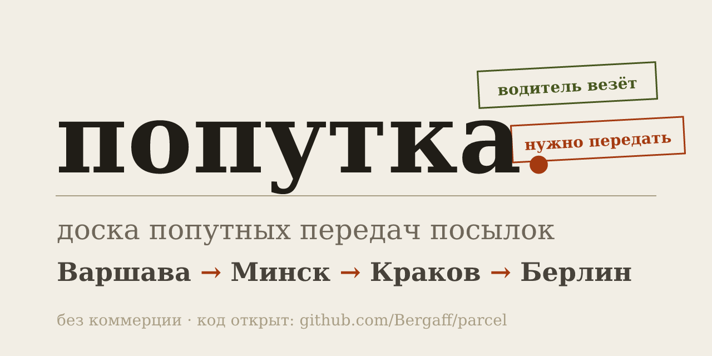

# попутка. — доска попутных передач



Сайт для поиска передачи посылок между городами и странами. Водители международных и межгородских рейсов публикуют, что готовы взять посылку; либо человек ищет, кто поможет передать. Плюс Telegram-бот, который собирает объявления из чатов водителей и релокантов и кладёт их на доску.

**Онлайн:** [pop-utka.app](https://pop-utka.app) · [запасной адрес](https://parcel-61u.pages.dev) · бот [@parcel_transfer_bot](https://t.me/parcel_transfer_bot). Проект некоммерческий: без рекламы, комиссий и платы.

**Стек:**
- **Cloudflare Pages** — статическая страница объявлений (`public/`)
- **Cloudflare Workers** + [Hono](https://hono.dev/) — парсер Telegram, API и бот
- Cloudflare **D1** (SQLite) — объявления, жалобы, учёт обработанных сообщений
- Cloudflare **KV** — сессии бота, rate limit
- Telegram Bot API — вебхук без сторонних SDK

## Что умеет

- **Доска объявлений**: фильтр по типу («водитель везёт» / «нужно передать»), маршруту, дате, поиск. Регистр не важен ни в городе, ни в поиске по тексту: «амстердам», «АМСТЕРДАМ» и «Амстердам» находят одно и то же (нижний регистр хранится в колонках `*_lc`, см. миграцию `0007_city_search.sql` — раньше длинное название города роняло доску в 500: SQLite отвергал GLOB-шаблон «*[Аа][Мм][Сс]…» как слишком сложный).
- **Города — по-русски**: и на сайте, и в ботe города пишут кириллицей (знакомую латиницу бот сам переводит: Warsaw → Варшава).
- **Архив**: заявки с прошедшей датой уходят с доски в архив, месяц остаются доступны по ссылке и в `/поиск` (можно написать автору), затем удаляются cron'ом (`[triggers]` в wrangler.toml, раз в сутки; ручной запуск — `POST /api/admin/archive`).
- **Поиск в боте**: `/поиск Город` (алиасы `/search`, `/серч`) — все заявки по городу в обе стороны, разделённые на «водители везут» и «нужно передать»; работает и в группах.
- **Пересылка вместо добавления в чат**: объявление можно просто переслать боту в личку — оно пройдёт тот же каскад (правила → ИИ) и встанет в модерацию; пересылки дедуплицируются (канальный пост не создаст дубль, даже если бот уже есть в канале). Контакт заявки — автор сообщения (из forward-данных), а не пересыльщик; у заявок из каналов и супергрупп источник — кликабельная ссылка на исходное сообщение (t.me/c/…). Администраторам лимит пересылок не мешает: они пересылают объявления пачками по 30–50 штук за раз, и раньше на 31-й бот отказывался — объявления терялись.
- **Маршрут из цепочки городов**: водители пишут «Белосток-Кузница-Гродно», «Катовице, Варшава, Брест, Минск», «Минск Брузги Варшава» — маршрут считается от первого города к последнему, промежуточные остаются в описании (раньше «Белосток-Кузница-Гродно» превращался в «Белосток → Кузница»). Разделителями считаются и запятые, и «через»: «из Минска через Брест в Варшаву» → Минск → Варшава. Москва наконец склоняется («из Москвы в Краков» раньше оставалось без маршрута: окончание меняет букву, а не добавляет её), «мск» и «спб» — тоже города, а Бяла/Белая (Biała Podlaska) — один город в любом написании.
- **Подбор пар в админке (вкладка «подбор»)**: одна кнопка сравнивает всех водителей со всеми заявками «нужно передать» и показывает, кому написать. Фильтры: города («водители Варшава — заявки на передачу Минск»), окно по датам в днях, брать ли архив, считать ли пары с одним общим городом. Логика в `src/match.ts`: пара — только тот же маршрут (посылка едет туда, куда едет водитель, встречный рейс не подходит), даты в пределах окна, посылка не тяжелее, чем готов взять водитель, и это не один и тот же человек; оценка складывается из совпадения маршрута (60), близости дат (до 30), веса и наличия контактов. Прогон можно сразу отправить сводкой в Telegram админам, а на каждой паре — «скопировать сообщение» с готовым текстом для обоих. Неактуальный юзернейм (человек больше не возит) можно **скрыть прямо в паре**: кнопка «скрыть» у контакта убирает из подбора все его пары — и в текущем прогоне, и в будущих, и в истории прогонов (хранится в KV, `contactKeyOf` нормализует юзернейм и телефон по последним 9 цифрам). Сами заявки не удаляются. Скрытые показываются списком «Скрытые в подборе» с кнопкой «вернуть». То же самое из Telegram: команда `/подбор` (администратору), например `/подбор Варшава Минск 7 дней`, `/подбор Краков с архивом` — сводка приходит в чат, прогон сохраняется в ту же историю.
- **История подборов**: каждый прогон сохраняется (`match_runs` + `match_pairs`, миграция `0005_matches.sql`) вместе со снимками заявок — поэтому старый подбор остаётся читаемым, даже когда сами объявления удалит cron. В админке прогон можно открыть заново или удалить.
- **Правка объявлений в админке**: кнопка «редактировать» есть и в очереди модерации, и на вкладке «на доске» — меняются тип, маршрут, дата, вес, цена, описание и контакты (`PUT /api/admin/listings/:id`). Сохранить можно и без контакта: у пересылок от людей со скрытым профилем контакта не бывает (Telegram его не отдаёт), поэтому модератор вписывает номер или @username вручную — например, из исходного сообщения по ссылке «источник». Если контакт так и не появился, заявка всё равно сохраняется, а админка и Telegram-карточка предупреждают об этом.
- **Поток заявок и самые просматриваемые** (вкладка «итоги» в админке, самый верх): сколько заявок **пришло, одобрено и отклонено** — по дням, неделям и месяцам (переключатель под графиком), плюс **график «везут / нужно передать»** (столбики по типам, наведение показывает числа). Считается по дате подачи заявки; живые строки дают текущие цифры, а историю cron фиксирует дневными снимками `stats_daily` (таблицу создаёт воркер, как `stats_months`; пересчитываются только вчера-сегодня и пропущенные дни — удалённые заявки не «худят» зафиксированные дни, при первом прогоне — бэкфилл за 90 дней). Рядом — **самые просматриваемые** заявки (живые и архивные, топ-10 по счётчику просмотров, ссылками на карточки).
- **Отбойник для водителей без контакта — из любого источника**: заявка «могу передать» (offer) без контакта в полях и без телефона/@юзернейма в описании не принимается вовсе. С сайта — сразу 400 с просьбой указать контакт; из бота (личка, пересылки, чаты) — создаётся сразу со статусом «rejected»: в очереди модерации таких заявок больше нет, переславшему бот отвечает «не принято: нет контакта» (`autoStatusFor` в `src/store.ts` — единая точка для всех источников). С контактом прямо в тексте описания — проходит на модерацию как обычно, модератор переносит контакт в поле.
- **«Ищу попутчика» без контакта — конвейер новых пользователей**: заявка «нужно передать» без телеграма и телефона публикуется **автоматически** и **прячется с доски** — из любого источника: сайт, личка бота, пересылки, чаты (раньше правило действовало только для формы на сайте; `isHiddenRequestInput` больше не смотрит на источник). Неважно, кто подал — человек или админ с ключом. На доске её **не видно** — нигде: не в списке, не в счётчиках, не в архиве, не на страницах городов/маршрутов, не в карте сайта. Видна только в подборе пар и в админке (штамп «скрыта · только подбор»), а владельцу сразу приходит карточка в Telegram — он пишет людям сам. Автор заявки после отправки видит её на своей странице (`/item/:id` работает по прямой ссылке) и сообщение «подбираем попутчика». Форма при этом разрешает «нужно передать» без контакта (водителям — по-прежнему обязательно). Живёт такая заявка 30 дней (без даты выезда — по возрасту), потом архив и удаление cron'ом (`hidden`-колонку создаёт воркер, как `recurring`; логика — `isHiddenRequestInput` в `src/store.ts`).
- **Очередь модерации — три удобства** (`public/app.js`): заявка без контакта подсвечена рамкой и цветом («контакт не указан») — публиковать её бессмысленно, это видно с первого взгляда. «Одобрить»/«отклонить»/«удалить» и сохранение правок убирают или перерисовывают только свою карточку — очередь больше не перезагружается целиком («загружаю…» и список с самого верха), открытые «связи» соседних заявок и прокрутка остаются на месте. При открытии очереди сервер сам удаляет заявки с уже прошедшей датой выезда (`pruneStalePending`, регулярные рейсы не трогает) и сообщает в счётчике, сколько удалил. У каждой карточки — штампы происхождения: серый «с сайта» / «из чата» / «из бота», синий «от админа» (свой Telegram боту или форма с ключом админки) и терракотовый **«от другого человека»** — заявку подал посторонний: написал боту в личку не-админский ID или отправил форму с сайта из браузера без ключа админки (в базе `by_admin`: 1 — админ, 2 — человек, 0 — из чата/старые строки; старые заявки из лички бота распознаются по sourceChat).
- **Защита от дублей при повторных пересылках**: водитель может каждый день писать «20 сентября готов быть, Варшава — Минск», а админ — каждый день это пересылать и одобрять; раньше на доске появлялась новая заявка за каждым разом (отметка «уже обрабатывал» не помогала: каждый день это новое сообщение). Теперь заявка сравнивается с уже имеющимися (`src/dedupe.ts`): тот же тип, тот же маршрут и дата в пределах дня плюс признак «это тот же человек» — совпал контакт (юзернейм или телефон с точностью до последних 9 цифр), совпал автор пересылки («Переслано от …») или текст совпал на 80% и больше. В этом случае вторая заявка не создаётся: существующая освежается (поднимается вверх доски), переславшему приходит «такое уже есть, дубль не создавал», модератору — короткая заметка. Предупреждение «тот же источник, маршрут, дата — проверьте, не один ли это человек» показывается **только когда обе заявки без контактов вовсе** (человек со скрытым профилем пересылает одно объявление): на популярном маршруте в один чат пишут и разные люди, и если хоть у одной заявки есть контакт (в поле или в описании) — молчим, сравнивать есть что. Разных людей система не склеивает: если контакты известны и разные, заявка создаётся всегда; копия чужого текста другим человеком создаётся, но в очереди модерации помечается «похоже на дубль» с объяснением. Та же проверка срабатывает при публикации через форму на сайте (возвращает уже существующую заявку) и при одобрении в админке (предупреждает, если такая заявка уже на доске). Мастер `/post` человек заполняет сам — заявка создаётся в любом случае, но с предупреждением. **Дедупликация зависит от того, кто подаёт** (колонка `by_admin`, создаёт сам воркер): пересылки и сообщения от админских Telegram ID и форма с ключом админки сливаются как раньше, а заявку постороннего человека (сайт без ключа, личка бота) дубль не поглощает — она создаётся отдельной, модератору в Telegram приходит конфликт «человек подал сам, а похожая уже есть», и в очереди у неё есть кнопка **«заменить старую»**: старая (принесённая из чата) удаляется, заявка человека публикуется (`POST /api/admin/listings/:id/replace`).
- **Разбор уже накопившихся дублей (вкладка «повторы»)**: защита выше не создаёт новых копий, но до неё одно и то же объявление успевали одобрить по несколько раз. Вкладка «повторы» в админке (`GET /api/admin/duplicates`) раскладывает живые заявки на группы одинаковых — тот же человек и тот же рейс — и показывает, какую заявку оставить (та, что на доске и с контактом), а какие копии удалить. Копии удаляются по одной, группой или все разом (`POST /api/admin/duplicates/clean`, вместе с жалобами на них); «похожие» заявки разных людей в группы не попадают — их решает модератор.
- **Связи заявок**: `/связи №` (алиасы `/матч`, `/match`) — встречные рейсы, тот же маршрут ±3 дня и другие заявки того же контакта; в админ-панели — кнопка «связи» на каждой карточке. Таблицу ссылок `chat_links` можно создать одним кликом на вкладке «чаты» (POST `/api/admin/ensure-chat-links`), если миграция 0002 ещё не применена.
- **Регулярные рейсы** («каждый четверг», «по вторникам и пятницам», «ежедневно», «по будням», «раз в неделю»): расписание распознают и правила (`parseRecurring` в `src/parser.ts`), и ИИ (поле `recurring` в ответе DeepSeek); видно сразу в трёх местах — штамп «регулярно» и строка «↻ каждый четверг, ближайший 24 сен» на доске, ячейка «регулярно» в карточке, строка «Регулярно:» в карточках Telegram. Такое объявление **не уходит в архив**, когда дата заезда прошла: суточный cron катит `departure_date` на ближайший заезд по расписанию (`nextRecurringDate`), поэтому водитель «каждый четверг» не пропадает с доски в пятницу утром. Живёт расписание, пока его освежают (пересылки, дедупликация); 45 дней тишины — считаем, что рейс закончился, заявка удаляется. Дедупликация учитывает расписание: один и тот же человек с рейсом «каждый четверг» не плодит заявку каждую неделю, даже когда ближайшие даты разъехались. Колонку `recurring` в базе создаёт сам воркер (`ensureRecurringColumn`) и тут же размечает накопившиеся объявления по тексту описания — как миграция 0007 поступила с колонками `*_lc`, отдельной миграции не нужно. Колонку гарантируют и пути чтения (доска, счётчики, поиск по городу), а не только записи: свежая база без единого объявления раньше отдавала 500 на главной, пока бот что-нибудь не создаст; бэкфилл `recurring` при этом сам сначала просит `*_lc` — он читает `description_lc`. Расписание можно задать руками: поле «Регулярный рейс?» в форме на сайте, ответ «каждый четверг» на шаге «Когда?» в мастере `/post` и поле «Регулярно» в редактировании заявки в админке.
- **Несколько направлений из одного сообщения** (туда-обратно, два рейса, «18-19.9 туда, 20-21.9 обратно»): такие сообщения всегда уходят ИИ, который возвращает до 3 отдельных заявок — по одной на направление (максимум 3, каждая со своим маршрутом и датой).
- **ИИ-оформление «трудных» объявлений (DeepSeek)**: если правила не уверены (необычный формат, неизвестные города), сообщение уходит в DeepSeek, который возвращает строго JSON; ответ жёстко валидируется (города кириллицей, дата в пределах года, контакты) и попадает на модерацию с пометкой «ИИ-разбор». Дневной лимит — 300 вызовов. Включается секретом `AI_API_KEY` (без него бот работает только на правилах); опционально `AI_MODEL` (по умолчанию `deepseek-chat`). Экономия API: результат разбора кэшируется в KV по хэшу текста (`ai:txt:<sha256>`, 3 дня) — кросспост одного объявления в несколько чатов разбирается один раз, а «не объявления» (вопросы из чатов) не дёргают API повторно; кэш хранит сырой ответ и при чтении валидируется заново, так что просроченные даты отсеются сами. Чем разобран текст — внутренняя деталь: ни на сайте, ни в карточках Telegram пометка «ИИ-разбор» больше не показывается (в подписи источника остаются только чат/автор пересылки и ссылка на исходное сообщение). Упоминание DeepSeek сохранено лишь на странице «Приватность» — это раскрытие обработки данных, а не метка объявления.
- **Тип заявки — по тому, кто действует**: «возьму/везу/есть место» → «водитель везёт», «нужно передать/ищу/кто везёт» → «нужно передать». Тематические слова («перевоз», «доставка», «груз», «рейс») признаками водителя больше не считаются: просьба «подскажите, кто-то занимается перевозом посылок до 20 кг? варшава-брест?» раньше получала штамп «водитель везёт», теперь определяется как «нужно передать». Спорные сообщения (признаки обеих сторон почти равны) правила отдают ИИ — `confidence` падает ниже 0.7.
- **Без дублей в карточке**: контакты нормализуются (`normalizeContacts` в `src/util.ts`) — номер, попавший в поле `telegram`, переезжает в `phone`, один и тот же номер в двух полях остаётся одним контактом, поэтому строка «Контакты:» печатается один раз (через запятую, если контакта действительно два), а сайт не строит битую ссылку `t.me/+48579264254`. Описание заявки (`dedupeDescription`) не повторяет поля карточки: из текста, который сочинил ИИ, вычёркиваются маршрут, дата, вес, цена, слово «водитель» и контакты, из дословного текста сообщения — только контакты и точные повторы предложений (переносы строк автора сохраняются). Старые строки в базе чистит миграция `0003_contact_dedupe.sql`.
- **Только посылки**: пассажирские попутки («Пассажир. Гродно-Минск», «кто подвезёт до…», «ищу 1 место, рюкзак», «ищу 3 места Минск-Варшава в аэропорт») бот пропускает — в личке вежливо объясняет, что доска про посылки; объявления водителей («есть места», «возьму попутчиков») публикуются.
- **Нормальные адреса вместо хешей**: History API (`/item/…`, `/?from=Варшава&to=Минск`) и серверный рендер — воркер отдаёт готовый HTML (первые 20 заявок на главной, карточка объявления целиком, разделы `/how`, `/bot`, `/terms`, `/privacy`, `/new`, `/admin`), а `public/app.js` подхватывает состояние и дальше работает как SPA: клик по строке открывает карточку за ~40 мс без перезагрузки. Старые ссылки с `#/` конвертируются при загрузке, снятые и неизвестные объявления — честный 404 (`public/404.html`) вместо редиректа на главную.
- **Явные повторы не доходят до модератора**: окно поиска дублей — самые свежие заявды, а не «сначала все опубликованные» (при большом объёме доски и архива свежие копии из очереди вытеснялись из окна, и чат с автоперепостом каждые 10 минут заводил десяток одинаковых карточек). При загрузке очереди явные повторы (`duplicate`: тот же контакт/автор/текст + маршрут + дата) отклоняются автоматически — в счётчике «повторов отклонено: N»; заявки, поданные самим человеком, не трогаются («заменить старую» решает модератор). Карточка «Повтор, дубль не создавал» админам — не чаще одной в 6 часов на заявку.
- **Статистика аудитории `/mediakit` — для рекламных бирж**: независимый счётчик «как у аналитики». Воркер видит каждый просмотр контентных страниц (включая попадания edge-кэша), различает людей и роботов по User-Agent, обезличивает посетителя суточным хешем IP+браузер (IP не хранится), «живой браузер» подтверждает JS-маячок app.js (`/api/visit-confirm`). Страница: периоды 24 часа / 7 / 30 дней, плитки (посетителей в день, просмотры — только живых посетителей, роботы в отдельной плитке «отфильтровано», страниц на посетителя, подтверждены браузером %), график и таблица по дням, география с флагами и строкой про VPN/дата-центры, устройства, ОС, источники трафика (Telegram / Поиск / Соцсети / Другие сайты / Напрямую) и топ-рефереры, страницы, блок Telegram-бота (чатов всего / активных за период), методика подсчёта, «Скачать CSV» и «Печать / PDF». Сырые данные — 90 дней, чистит cron; «покрыт данными» считается по дням с живыми визитами; счётчик чатов Telegram-бота при первом запуске засеивается из истории объявлений, а не с нуля. **Логин и пароль задаются в админке** (вкладка «настройки»): сохранённая пара главнее секретов `MEDIA_LOGIN` / `MEDIA_PASSWORD`, кнопка «сбросить» возвращает секреты; пароль хранится только хешем. Закрыто от индексации, `Cache-Control: no-store`, брутфорс-щит 10 попыток / 15 минут.
- **Живая аудитория в таблицах медиакита**: география, устройства, ОС, источники и страницы считаются только по посетителям, подтверждённым JS-маячком. Сырые логи «красит» бот-трафик с браузерными User-Agent из дата-центров (США/Азия, «iOS», 95% «напрямую») — на молодом домене его больше, чем людей, и география выглядела американской. Маячок теперь работает и на SEO-страницах маршрутов/городов (у них нет app.js — шлют inline-скриптом), список дата-центров/VPN по AS-организации расширен, а гистограмма «Динамика по дням» печатается в PDF с цветом (`print-color-adjust: exact` — без него браузеры выкидывают фоны при печати); маячок в app.js отправляется первым действием при загрузке — сбой в другом коде страницы не может «потерять» живого посетителя. С v0.4.6 **вся страница медиакита** — плитки, график, таблица по дням и CSV — считается только по живой аудитории (без плитки «сырых» цифр и процента подтверждений): сырые просмотры уходят в примечание под плитками, а роботы — в плитку «отфильтровано» и столбец таблицы.
- **Fallback рекламной сети** (`/fallback.js`): сеть грузит его, когда ей нечего показать в слоте, — вместо пустоты показываем «свой баннер» с приглашением в бота. Сработает только внутри рекламного iframe (на страницах сайта — no-op), внешних запросов не делает; кэш 5 минут, так что правится мгновенно. Файл целиком ASCII (русский текст баннера — через `\u`-последовательности): в любой панели или редакторе с любой кодировкой он выглядит одинаково, а в браузере баннер остаётся русским.
- **Фавикон с версией в URL** (`?v=<версия сайта>`): каждый релиз меняет адрес иконки, и Google/Яндекс пере-скачивают её, а не держат в кэше старую (или закэшированный «глобус»/404 времён data-URI). Прямые пути (`/favicon.ico` без `?v`, которые любит Яндекс) отдаются с `Cache-Control: max-age=3600`, а не недели — замена иконки видна поисковику в течение часа.
- **Уведомление об одобрении не теряется при сбое**: наблюдатель снимается только после успешной отправки сообщения (раньше сбой сети мог «съесть» уведомление — человек нажал кнопку, а сообщения не пришло). Подпись полей формы стала короче («Цена или оплата», «Регулярный рейс» без хвоста «(необязательно)» — одна общая пометка под сеткой), треки сетки `minmax(0, 1fr)` и `width: 100%` у инпутов убирают распирание страницы вбок.
- **Невидимые символы не ломают команды**: zero-width (U+200B–200D), BOM, мягкий перенос и узкие пробелы (NBSP и др.) нормализуются перед разбором любой команды — диагноз из прод-логов: «/здесь …» доходило до воркера (след `tg cmd`), но воркер завершался за 0 мс без единого запроса к базе, потому что регэксп команды не совпадал из-за невидимого символа; в диагностическом следе теперь печатаются и юникод-коды первых символов команды (`codes: 2f 7364 ...`).
- **Команда не может замолчать в принципе**: необработанное исключение внутри любой команды (`/здесь`, `/форум`, `/комнаты`, `/описание`, `/поиск`, `/репорт` — в группе и в личке) превращается в ответ в тот же чат с точным текстом ошибки, а если и он не ушёл — в эскалацию админам в личку и громкий лог. Копии и предупреждения в личку, которые не доставлены (админ ни разу не писал боту `/start` — Telegram запрещает ботам писать первыми), логируются с подсказкой вместо тихого исчезновения. Хвост из прод-логов: команда `/здесь Дубай` пришла чистой (коды `2f 437 …` — посторонних символов нет), значит молчать мог только тихий внутренний сбой — теперь такое видно в чате.
- **Команды от ботов-аккаунтов больше не молчат**: следующий хвост из прод-логов — `tg cmd` печатался, а запрос умирал за 2 мс без единого обращения к D1. Виновник: команда приходила с `from.is_bot = true` (релей, автопостер или отправка через Bot API от имени другого бота) и молча съедалась фильтром «не реагируем на ботов». Теперь `/здесь`, `/комнаты`, `/форум` и `/описание` от ботов разбираются: чужому боту уходит видимая подсказка с его Telegram ID, боту из `ADMIN_IDS` (релей админа) — полноценная обработка; объявления и посторонние команды от ботов по-прежнему игнорируются (шум и дубли). Диагностический след `tg cmd` печатает и автора: `from <id> @<username> бот|человек`.
- **Сброс статистики канала**: во вкладке «канал» админки появилась кнопка «сбросить счётчики» — после перенастройки комнат (`/здесь`) прежние счётчики, доли и топ «прочего» описывают уже не существующие комнаты. Сброс обнуляет обе таблицы (сводные счётчики, которые показывает бот в `/комнаты`, и события публикаций с процентами) и накопляет их заново; заявки, доска и настройки комнат не затрагиваются. Кнопка спрашивает подтверждение, после сброса вкладка перезагружается с сервера (`POST /api/admin/forum-stats/reset`).
- **Предупреждение о подозрительно далёкой дате выезда**: «выезд 29 сентября 2027» при добавлении 30 сентября 2026 — в объявлении дата была без года, день уже прошёл, и парсер подставил следующий (`src/parser.ts`). Карточки в очереди модерации и на доске получают заметное предупреждение «⚠️ Выезд через N мес. — подозрительно далеко… поправьте кнопкой „редактировать“» (порог — дальше 90 дней; регулярные рейсы с расписанием не предупреждаются). Под счётчиком «На доске: N — действующие и архив» — строка «⚠️ Подозрительно далёкая дата выезда: X на доске · Y уже в архиве»: числа — серверные `COUNT` **раздельно** по статусам, потому что кнопка «убрать все такие с доски» архивирует только действующие (раньше один счётчик смешивал статусы: после архивации строка говорила «25 объявлений», а кнопка отвечала «Убрано в архив: 0»). Кнопки: **«показать все такие»** (серверный фильтр `GET /api/admin/listings?tab=board&odd=1` — только эти объявления с разбивкой «на доске / в архиве»; возврат — «показать всю доску») и «убрать все такие с доски» (`POST /api/admin/board/archive-far`, показывается только когда на доске есть что убирать); кнопка «на доску» на карточке возвращает любое, `published_at` сохраняется.
- **Маршруты-цепочки** (`v0.4.55`): «Минск-Брест-Белосток-Варшава» — одна заявка, а не четыре, и промежуточные города больше не теряются (раньше парсер брал только первый и последний). На доске и в карточке цепочка показывается как «Минск **…** Варшава»: при наведении на многоточие видны все города маршрута, скринридеру — «через Брест, Белосток». В поиске такая заявка находится по **любой** паре городов цепочки в правильном порядке (Минск→Брест, Брест→Варшава, Минск→Варшава; обратный порядок «Варшава→Брест» — нет), по городу посадки/высадки и в q-поиске. В подборе предлагается: водитель-цепочка покрывает сегмент посылки («проезжает сегмент», оценка почти как полное совпадение) и наоборот — водитель везёт участок маршрута посылки («везёт участок»). Цепочку хранит колонка `stops` (JSON) плюс три поисковые колонки (посадка/высадка/порядок) — миграцию делает сам воркер, старые строки читаются как обычная пара. Цепочку возвращают и правила парсера, и ИИ (поле `stops`, несогласованная с концами цепочка отбрасывается). Правка городов в админке схлопывает цепочку — старая стала бы врать, правка прочих полей её бережёт. Обычные пары городов рисуются прежней стрелкой — ничего не изменилось.
- **Честные просмотры в «Самых просматриваемых»** (`v0.4.54`): отчёт раньше строился по сырому счётчику `listings.views`, который крутился только на кликах внутри сайта (API карточки): прямые заходы из поиска и по ссылкам из Telegram не считались вовсе, боты и собственные заходы владельца не отсекались, обновление страницы накручивало счётчик. Теперь просмотры заявок пишутся в отдельную `stat_item_views` — одна строка на человека в сутки на заявку (`PRIMARY KEY day+listing+vid`, `INSERT OR IGNORE`), с флагами бота и владельца; запись идёт на обоих путях (SSR `/item/:id` через мидлварь и API `/api/listings/:id`), тот же суточный vid, что в медиаките. Отчёт = число живых людей (`bot=0 AND own=0`), подпись в админке объясняет счёт. Сырой `views` остался как технический счётчик открытий. Храним 400 дней (cron-чистка), поэтому отчёт почти «за всё время», но таблица не растёт бесконечно. После деплоя числа начнут набираться заново — старые сырые значения в честный отчёт не переносились.
- **Отчёт по юзернеймам в админке** (`v0.4.53`): во вкладке «статистика» появилась таблица «Чьи юзернеймы чаще всего в заявках» — топ контактов-`@username` по всем заявкам (живые и архив, кроме отклонённых): сколько всего заявок, разбивка «везёт / ищет», доля от числа заявок с юзернеймом и когда последний раз попадался. Группировка без учёта регистра (`@Ivan` и `@ivan` — один человек), юзернейм — ссылка на `t.me`. Данные берёт `listTopUsernames()` вместе с остальной статистикой (`/api/admin/stats`), отдельный запрос не добавляет.
- **Сайт говорит правду при сбоях** (`v0.4.52`): авария Cloudflare D1 29.10.2026 (`D1_ERROR: internal error; reference = …` — платформенный сбой: все запросы к базе падали, статика работала) показывала посетителям голый «Internal Server Error», а Яндекс и Google получали 500 — сигнал «страница сломана». Теперь непойманное исключение отдаёт честный **503** с `Retry-After: 300`: посетителю — страницу «Сайт временно не отвечает» в фирменном стиле (сбой на стороне хостинга, обычно проходит за минуты, ничего не потерялось), API и форме — JSON `{ error: 'temporarily_unavailable' }`; для краулеров 503 означает «сбой временный, страницу не выкидывать из индекса». Сам сбой в edge-кэш не кладётся (кэшируются только 200/404), а если копия страницы в кэше колокации ещё жива — она продолжит отдаваться, даже когда D1 лежит. Telegram-webhook раньше глотал любую ошибку и отвечал 200 — сообщения, пришедшие в бота во время аварии, терялись молча; теперь именно при аварии D1 webhook отвечает 503 и Telegram повторяет доставку апдейта (прочие ошибки — как раньше, `{ ok: false }`: ретраить разбор мусора бесполезно).
- **Архив удаляется через неделю** (`v0.4.51`): заявки с прошедшей датой выезда уходят с доски в архив и ещё **7 дней** доступны по ссылке (раньше — месяц), затем cron удаляет их насовсем. Та же недельная жизнь в архиве у бездатных заявок: видимые без даты — 21 день на доске → архив → ещё 7 дней → удаление (28 суммарно, было 51); скрытые «ищу попутчика» без контакта и даты — 30 дней невидимки → архив → ещё 7 дней → удаление (37 суммарно, было 60). Архивное окно в /поиск и CSV-выгрузке сужено до тех же 7 дней. Тексты синхронизированы: карточка объявления говорит «Ещё неделю она доступна по ссылке», вкладка «архив» в админке — «живут неделю». Закрытые месяцы в «итогах» не пострадали: цифры хранятся снимками `stats_months` и от жизни строк не зависят.
- **Приватные источники не видны на сайте** (`v0.4.50`): подписи «Переслано от <имя>», «из чата «Пересланное сообщение»» и «из чата «Личное сообщение боту»» — детали приватного общения с ботом: кто и как переслал объявление, посторонним это не нужно. На публичной доске (серверные строки и карточки SSR + клиентский `app.js`) такая подпись источника не печатается вовсе — `span.src` в строке и ячейка «источник» в карточке просто отсутствуют. Реальные чаты («из чата «Граница BY-LT-PL»», включая ссылку, которую админ задал сам) и «с сайта» остались как были. В админке и выгрузках видно всё: полная подпись строится прежней `sourceLabel()`, приватные значения отсекает отдельная `publicSourceLabel()` (проверяет сырой `sourceChat`, а не готовую подпись — «Пересланное сообщение» подпись заворачивает в «из чата «…»»).
- **Подбор: ссылка на исходное сообщение и скрытие заявок без контакта** (`v0.4.49`): в парах подбора (свежий прогон и история) у каждой стороны рядом с «№ заявки» появилась та же админская ссылка на исходное сообщение — `t.me/<чат>/<тема>/<сообщение>` или `t.me/c/…`; снимок пары (`match_pairs.offer_json/request_json`) теперь несёт поля происхождения, старые снимки без них читаются как раньше (просто без ссылки). Заявку без контакта раньше нельзя было скрыть юзернеймом — скрывать было нечего: теперь у стороны без контакта есть кнопка «скрыть заявку», она пишет ключ `id:<uuid>` в тот же KV-список `match:hidden-contacts`, и `filterHiddenPairs` убирает пару и из свежего прогона, и из истории, и из будущих прогонов. В списке «Скрытые в подборе» заявка видна с подписью «№ … · маршрут» и кнопкой «вернуть». Заодно исправлен потолок списка: `slice(0,200)` при переполнении молча отбрасывал НОВОЕ скрытие — теперь `slice(-200)`, выпадают старейшие.
- **История подборов живёт 3 дня** (`v0.4.48`): прогоны вкладки «подбор» хранят снимки заявок в парах, и уже через пару дней они устаревают — заявки либо разобраны, либо сняты с доски. Прогоны и их пары старше 3 дней удаляются автоматически: cron раз в сутки и админка прямо перед показом истории, поэтому счётчик «История подборов: N» всегда показывает живые прогоны, а под списком появилась подпись о сроке хранения. Порог удаления — через `datetime()` с обеих сторон (`created_at` прогонов пишется `toISOString()`, а голое сравнение строк ломается на `T` — урок `v0.4.44`); проверено на настоящей D1: ISO-метка и метка с пробелом четырехдневной давности удаляются одинаково. Пары удаляются явно до прогонов — на `ON DELETE CASCADE` не полагаемся. Ручное «удалить» у прогона осталось.
- **Тема исходного сообщения доезжает до заявки** (`v0.4.47`): радар шлёт вторым сообщением ответ (reply) на каждую пересылку — только ссылку на исходное сообщение, `t.me/<чат>/<тема>/<номер>` или `t.me/c/<id>/<тема>/<номер>` для защищённых чатов; сама пересылка тему не несёт, Bot API её не отдаёт. Бот перехватывает такой ответ до всех остальных веток: находит заявку, созданную из сообщения, на которое пришёл reply (пересылки теперь помнят связь «сообщение в личке → заявка» в `tg_seen` под ключом `pm:<чат>`, текстовые копии — под id чата), дописывает ей username чата, тему и номер сообщения — и молчит: голая ссылка не объявление и не ответ мастера, даже с активным `/post` она не попадёт в шаг «город». Заявку не нашли (пересылка оказалась болтовнёй) — ответ всё равно поглощён без шума. Карточка, которую модератор получил в момент пересылки, тему уже не догонит — актуальная ссылка живёт в админке и `/pending`. Текстовые копии из защищённых чатов раньше вообще не имели источника, кроме «Личное сообщение боту»: теперь и у них в карточке админа ссылка на исходное сообщение; если названия чата нет, строка «Источник» показывает саму ссылку.
- **Происхождение заявки видно только админам** (`v0.4.46`): у каждой заявки теперь хранятся публичный username чата-источника, тема форума и номер сообщения. В админке рядом с подписью источника появляется ссылка на исходное сообщение — `t.me/<чат>/<тема>/<сообщение>` для публичных чатов (открывается у всех, как ссылка в темах групп) и `t.me/c/…` для приватных супергрупп (открывается у участников). Те же данные исчезли оттуда, где их видят посторонние: карточки в общих чатах и ответы авторам больше не печатают строку «Источник» (она осталась только в карточках модератору), публичная доска не выдаёт ссылку на сообщение в подписи чата, а из ответов `/api/listings` и кэша `window.__SSR__` срезаются `sourceMessageId`, `sourceChatUsername` и `sourceThreadId`. Единственное исключение — заявка, где контакта нет вообще (ни в полях, ни в тексте описания): там ссылка на исходное сообщение остаётся и в публичной карточке, потому что это единственный способ связаться с человеком. У старых заявок username и тема неизвестны: колонки добавляет миграция `0011` (на проде воркер добавит их сам при первой записи), таким заявкам остаётся ссылка `t.me/c/…` для участников чата.
- **Заявки перестали падать в «прочее» из-за незнакомых городов** (`v0.4.45`): комнату форум-канала выбирает страна города, а страну бот брал из словаря витрины (`CITY_COUNTRY`), где на всю Беларусь девять городов — Пинска, Волковыска, Лиды, Кобрина, Ошмян там нет. Добавлять их в витрину нельзя: из того же словаря строятся страницы `/gorod/`, и каждый новый город означал бы новую SEO-страницу. Появился отдельный словарь `src/forum-cities.ts` — 2900 городов в 70 странах: райцентры, курорты, пункты пропуска («Гродно → Кузница», «Каменный Лог → Мядининкай») и всё, что встречалось в заявках чаще раза. Он используется только для выбора комнаты и для разбора `/здесь`: список стран бота тоже строился из витрины, поэтому `/здесь Россия ↔ Турция` или `/здесь Беларусь ↔ Беларусь` раньше не разбирались вовсе. Замер на настоящей выгрузке (3450 опубликованных заявок за 30 дней, комнаты как в проде): в «прочее» уходило **940 публикаций (27,2%)**, со словарём — **825 (23,9%)**, то есть 115 публикаций в месяц переехали в уже существующие комнаты без единой новой темы; с комнатой «Беларусь ↔ Беларусь» — 638 (18,5%). Неизвестный город по-прежнему уходит в «прочее»: выдуманная страна хуже её отсутствия. Размер словаря — 169 КБ исходника, 24 КБ в gzip; ключи складываются без `normalizeCity`, чтобы 2900 вызовов нормализации не попали в CPU-лимит воркера на старте модуля.

- **Заявки старели на день позже срока** (`v0.4.44`): метки времени в базе лежат в двух форматах — `toISOString()` при создании (`2026-10-02T01:00:00.000Z`) и `datetime('now')` при освежении (`2026-10-02 01:00:00`). SQLite сравнивает их как строки, а `T` (0x54) больше пробела (0x20), поэтому ISO-метка на границе срока выглядит «моложе», чем есть. Замер на настоящей D1: `'2026-10-02T01:00:00.000Z' < datetime('now','-21 days')` даёт **0** при границе `2026-10-02 06:29`, хотя время раньше; та же метка в формате с пробелом даёт 1. На доске 23.10.2026 так висели две заявки возрастом 22 дня. Теперь все пороги возраста (21/51 день без даты, 30/60 для скрытых, 45 для регулярных, 90 для отклонённых) и все сортировки по метке обёрнуты в `datetime()`, а `touchListing` пишет метку в том же формате, что и создание. Заодно чинится порядок на доске: «освежить» (повторное «еду 20 сентября») поднимало заявку наверх только среди строк своего формата — внутри одного дня освежённая оказывалась ниже созданных раньше.

- **Страна вместо города больше не попадает на доску** (`v0.4.43`): в выгрузке 69 значений «города» оказались страной — «Россия» 15 раз, «Беларусь» 7, «Германия» и «Польша» по 6, дальше Италия, Черногория, Чехия, Таиланд, Бельгия, Япония, Израиль, Китай, Украина; у 14 заявок страна в обоих полях («Россия → Чехия», «Греция → Россия»). По стране не работает ничего: расстояние и пункты пропуска считаются по городам (`CITY_GEO`), страница маршрута не строится, поиск попутчиков не сходится. `countryInsteadOfCity` узнаёт страну и в каноническом написании, и в вариантах («РФ», «Белоруссия», «Америка», «Сша», «Голландия», «Україна», «Кыргызстан»). Входы ведут себя по-разному, но не молчат: форма сайта и правка заявки отвечают «Укажите город, а не страну: «Россия» — например, «Москва»» (пример города берётся из `CITY_GEO`, поэтому подсказка конкретная), бот на шаге «откуда/куда» просит город и шаг не засчитывает, разбор чатов такое не публикует вовсе. Спорные названия, которые одновременно и страна, и город (Тунис, Люксембург, Кувейт, Монако, Панама), в список не включены — отбирать их значит блокировать настоящие заявки. Правила шага бота вынесены в чистую функцию `cityAnswer`, чтобы проверяться юнитами без подделки Telegram. Те 69 заявок, что уже висят на доске, правка не трогает: бездатные состарит cron из `v0.4.39`, остальные нужно поправить руками.

- **Дубли, которые защита пропускала** (`v0.4.42`): разбор настоящей выгрузки нашёл на доске 29 групп, где один и тот же контакт держит 2–3 заявки одного маршрута (`Тересполь → Брест @romanak0707` — три штуки, все без даты). Дедуп умел сравнивать только поля `telegram`/`phone`, а у 82 заявок на доске контакт написан прямо в описании — теперь `sameContact` видит и его: телефон по последним 9 цифрам, юзернейм без `@` и регистра, крест-накрест «поле против текста». Если в полях у обоих стоят РАЗНЫЕ контакты, совпадение в тексте дублем не считается (в пересланном объявлении может быть номер диспетчера) — заявка создаётся, но модератор получает «похожее»: «в полях контакты разные, но один из них совпал с контактом из текста». Так же больше не молчит случай «тот же человек, тот же маршрут, даты через 3–16 дней» — 20 таких пар на доске: это либо регулярный рейс без проставленного расписания, либо повторный анонс; заявку не гасим, но показываем с подсказкой. В объяснениях `whoLabel` теперь называет контакт из текста вместо «без контакта».

- **Сниппет маршрута больше не обещает того, чего нет** (`v0.4.41`): описание страницы `/r/:slug` заканчивалось словами «даты выезда, вес, цена и контакт водителя». Сверка с настоящей выгрузкой: на доске 951 заявка, цена заполнена у 27 (3%), вес — у 46 (5%), дата выезда — у 397 (42%). Этот текст Google показывает в сниппете, а человек, пришедший за ценой, её не находит. Теперь `routeDescription` перечисляет только те поля, которые действительно заполнены в заявках этого маршрута: «даты выезда, цены и контакт водителя» → «даты выезда и контакт водителя» → «контакт водителя» → «кто едет по маршруту», если пусто всё. Факты считаются из заявок маршрута внутри `buildRoutePage`, поэтому у каждого `/r/` свой текст; вес из перечисления убран вовсе.

- **Даты, которые раньше терялись** (`v0.4.40`): 554 из 951 заявок на доске были без даты выезда. Заявки из чатов разбирает модель, и она честно возвращает `null` на «через 1час еду» или «в течении 1-2 часов», — теперь у `validateAiListing` есть запасной ход: если даты от модели нет, её достаёт правило из исходного текста сообщения. `parseDate` понимает относительные сроки («через час», «через 1час», «в течении 1-2 часов», «в течение 40 мин», «через 3 дня», «через пару дней», «через неделю/две недели/месяц», «на выходных» → ближайшая суббота, украинские «сьогодні», «післязавтра») и порядковые окончания между числом и месяцем («21-го октября», «3-е ноября», «6го октября»). Три защиты от выдуманных дат: «актуально **до** 30 октября» и «не позднее 20.09» — это срок годности заявки, а не выезд; «по 1.4$ за штуку» — цена (валюта сразу после цифр); «255/40r21» — размер шины (цифры, приклеенные к буквам). Дата без года, уехавшая дальше 120 дней, не отдаётся: раньше «по 1.4$» превращалось в 1 апреля следующего года. Замер на настоящей выгрузке: из 554 бездатных правило датирует 41 (36 — сегодня, 2 — завтра, 2 — на неделе, 1 — дальше), подозрительных ноль; у остальных 513 в тексте нет ничего про срок («Есть места», «Нужно передать документ») — их лечит старение из `v0.4.39`, а не парсер.

- **Заявки без даты выезда начали стареть** (`v0.4.39`): разбор первой настоящей выгрузки показал, что 554 из 951 заявок на доске (58%) вообще без даты, и у них не было механизма ухода — `archiveExpired` архивирует по прошедшей дате выезда (пункты 2–3 требуют `departure_date IS NOT NULL`), а жизнь по возрасту (пункт 5) была написана только для `hidden = 1`. Видимая бездатная заявка не старела никогда: накопилось 422 штуки, 317 старше недели, 21 старше месяца. Теперь пункт 6: 21 день на доске → архив, ещё 30 → удаление, возраст считаем от `COALESCE(published_at, created_at)`, регулярные рейсы не трогаем (у них дату катит пункт 1, мёртвых убирает пункт 4). В результате cron-лога появилось поле `dateless`.

- **Выгрузка спрашивает, что именно выгружать** (`v0.4.38`): рядом с кнопкой «экспорт в CSV» появился выбор области — только доска (по умолчанию), только архив, только модерация, только отклонённые или всё подряд; выбор уходит в `?status=`, а имя файла и тост его называют (`poputka-doska-2026-10-20.csv`, «Выгружено заявок: 951 (только доска)»). Повод — первый же настоящий файл: 3594 строки, из них 2577 архивных, а смотреть нужно было 951 живую. Заодно переносы строк внутри ячеек заменяются пробелом: у 205 заявок на доске описания многострочные («ночью около 02-00 / еду / Брест - Бяла»), и в Excel строка разъезжалась на несколько экранных.

- **CSV доезжает до Excel с BOM** (`v0.4.37`): в первой же выгрузке Excel на Windows показал «РЅР° РґРѕСЃРєРµ» вместо «на доске». Сервер BOM отдавал честно (проверено в байтах: `EF BB BF`), теряли его на стороне браузера — `Response.text()` по спецификации **снимает** BOM, а `Blob` строился из строки. Теперь в файл идут байты: `arrayBuffer()` → `new Blob([bytes])`, а строки для тоста считаются из расшифрованной копии; запасной путь (data-URL, если `createObjectURL` нет) дописывает BOM сам. Регресс закрыт jsdom-тестом на первые три байта **скачанного файла**, причём заглушка `Response` в тесте ведёт себя по спецификации и тоже снимает BOM в `text()` — иначе тест проходил и с багом (проверено мутацией: с прежним кодом падает `[34, 105, 100] ≠ [239, 187, 191]`).

- **Экспорт всех заявок в CSV** (`v0.4.36`, 627 тестов): кнопка «экспорт в CSV» в админке на вкладке «доска» — за ключом админки, на публичных страницах её нет. Отдаёт `GET /api/admin/listings.csv` со всеми заявками разом: доска, архив, очередь модерации и отклонённые, статус отдельной колонкой, сортировка по дате выезда вниз (заявки без даты — в конце). 21 колонка: id, статус, тип, откуда, куда, дата выезда, **дней до выезда** (отрицательное — дата прошла; так сразу видны протухшие и аномально далёкие рейсы), расписание, вес, цена, телефон, телеграм, источник, чат-источник, кто подал (админ / сам человек), создано, опубликовано, просмотров, скрыта, закреплена до, описание. Кодировка — **UTF-8 с BOM**, разделитель **`;`**, переносы **CRLF**, каждая ячейка в кавычках с удвоением внутренних: без BOM Excel на Windows показывает кириллицу как «ÐÐаѻ, а разделитель-запятая в русской, белорусской и польской локали сливает всю строку в одну колонку. Скачивание идёт через `fetch` с заголовком `Authorization` — ключ в адрес не попадает; число строк в тосте считается из самого файла, а не «на глаз». Необязательный фильтр `?status=published|pending|rejected|expired`, неизвестное значение работает как «все».

- **Местные названия городов** (`v0.4.35`, 604 теста): Search Console привёл украинские запросы, на которые сайт не отвечал — «попутники львів мостиска» (позиция 51), «попутчики киев» (53), «попутники львів володимир» (57), «попутники львів рогатин» (68), «попутники пісочна львів» (69), «попутка юа» (3). Сайт русский, и Google не связывал его с этими запросами. Теперь страница города пишет «другие названия: Київ (укр.), Kyiv (англ.)» (у Львова — ещё Lwów (польск.)), а адрес с местного написания отдаёт честный 301 на каноническую страницу: `/gorod/kyiv` и `/gorod/kiiv` → `/gorod/kiev`, `/gorod/warszawa` → `/gorod/varshava`, `/gorod/wroclaw` → `/gorod/vrotslav`, `/r/kyiv-lviv` → `/r/kiev-lvov`. Дублей страниц не появляется: редирект не ставится, если слаг уже канонический, неизвестен или занят другим городом. Карта `CITY_ALT_NAMES` (`src/seo-routes.ts`) — украинские, белорусские, польские, литовские, чешские, немецкие, итальянские, французские и английские написания; алиасы маршрутов строятся из всех сочетаний написаний пары и проверяются после того, как известны все существующие слаги. Заодно: 14 кириллических местных написаний добавлены в словарь парсера («Мостиська», «Гродна», «Брэст», «Магілёў», «Баранавічы», «Рогатин», «Стрий»), а Вроцлав, Лодзь, Жешув, Тернополь, Ровно, Винница, Луцк, Николаев, Хмельницкий, Чернигов, Запорожье, Днепр, Мостиска, Барановичи и Бобруйск появились в `CITY_COUNTRY` — раньше их страницы не подписывали страну и не получали редиректов.

- **«Не считать мои визиты» в медиаките**: разбор Search Console упёрся в «РБ это я мог быть» — 43 клика из 68 пришли из Беларуси, и отличить собственные заходы владельца от настоящих посетителей было нечем. Теперь в `/mediakit` (за паролем) есть кнопка-переключатель: она ставит браузеру куки `poputka_own` на год и помечает vid дня в таблице `stat_own`, а middleware учёта продлевает пометку на следующие дни. Все живые агрегаты медиакита (просмотры, уникальные, география, устройства, ОС, источники, рефереры, страницы) считаются с фильтром `NOT IN (SELECT vid FROM stat_own)`; рядом с плитками страница честно пишет «Из цифр исключены помеченные визиты владельца: N просмотра за период» и сообщает, помечен ли этот браузер. Роботы не помечаются, снятие пометки — та же кнопка («Снова считать мои визиты»).
- **IndexNow — мгновенная переиндексация в Яндексе и Bing (`src/indexnow.ts`)**: в Search Console сайт виден только с 18 сентября, а Яндекса в инструментах не было вовсе (ни IndexNow, ни Метрики) — при том что для Беларуси и России это половина поиска. Теперь любое изменение объявления (публикация, одобрение админом или ботом, правка, снятие с доски, отклонение) кладёт адреса `/item/<id>` и `/r/<слаг>` в таблицу-очередь `indexnow_queue`; после мутирующего запроса `/api/*` очередь сливается через `ctx.waitUntil` (ответ пользователя этого не ждёт), остатки доливает ежедневный cron. Если сеть не ответила или IndexNow вернул 4xx/5xx — адреса возвращаются в очередь и не теряются; входы два: `api.indexnow.org`, запасной — `yandex.com/indexnow`. Ключ создаётся сам и живёт в KV (`INDEXNOW_KEY` в секретах необязателен), поисковики проверяют его по `/indexnow-key.txt` — путь добавлен в `run_worker_first` в `wrangler.toml`, иначе assets-слой отвечает статичным `404.html` вместо воркера. После деплоя стоит открыть `https://pop-utka.app/indexnow-key.txt` и увидеть 32 шестнадцатеричных символа.
- **Блок «Сколько ехать» на страницах маршрутов (`src/geo.ts`)**: Search Console показал, что Google демонстрирует страницы маршрутов по запросам «варшава гродно расстояние» (позиция 40), «милан москва расстояние» (30), «как добраться до забайкальска из москвы» (36), «маршрутки иваново брест» (40) и «кузницу» (**позиция 2** — пункт пропуска Кузница/Брузги), а ответа на странице не было: показы шли, кликов нет. Теперь на каждом маршруте есть раздел с приблизительным километражом по трассе и временем за рулём («По трассе примерно 590 км — около 8 ч за рулём без долгих остановок»), для направлений через границу — её название и пункты пропуска («Брузги — Кузница, Берестовица — Бобровники, Домачево — Славатыче, Песчатка — Половце, Брест — Тересполь») с оговоркой, что режим работы меняется и его нужно уточнять; внутри Шенгена границы не выдумываем. Тот же факт — вопросом «Сколько ехать X → Y?» в «Частых вопросах» и в разметке FAQPage. Расстояния: 94 курируемых направления, остальные — оценка по координатам × 1,25 с округлением до 10 км; неизвестный город → блока нет вовсе (выдуманное расстояние хуже его отсутствия). 19 новых тестов.
- **Заголовок маршрута — под бюджет Google (`routeTitle`/`routeDescription` в `src/seo-routes.ts`)**: разбор Search Console показал `/r/vrotslav-minsk` на позиции 2,56 при 94 показах и всего 4 кликах (CTR 4,4% вместо 15–25% для топ-3) — старый шаблон «Передать посылку Вроцлав → Минск с попуткой — заявки водителей | попутка.» был 71–73 символа и обрезался в выдаче на полуслове («…— заявки води…»). Теперь заголовок выбирается из вариантов по бюджету ≤60 символов и несёт число живых заявок («Передать посылку Вроцлав → Минск — 12 заявок | попутка.»), для длинных пар — форма «Посылка …»; заявок нет — честное «с попуткой». Описание ≤160 символов начинается с фактов: «N живых заявок X → Y: даты выезда, вес, цена и контакт водителя». Тест перебирает все 57 витринных маршрутов × 0/1/4/27 заявок и проверяет длину.
- **`/здесь` виден со всех сторон**: подтверждение «Готово» дублируется админам в личку (даже если сообщение в группу не долетело — результат настройки видно сразу); при сбое отправки в группу админам в личку приходит «⚠️ Не смог ответить … <точный текст ошибки Telegram>», а не тишина; каждая команда логируется строкой `форум: /здесь от <id> админ: true/false группа <id> тема <n>`.
- **Диагностический след команд в логах**: каждая команда в группе пишется строкой `tg cmd <chat> <type> thread <n> <текст>` в логи воркера (Cloudflare → Workers → parcel → Logs) — если команда «не работает», по наличию строки сразу видно, дошла ли она до воркера; нет строки — Telegram не доставил сообщение (бот не админ/не в группе). Символ-вариант U+FE0F из эмодзи-стрелки «↔️» срезается при разборе направления.
- **Команды в группах понимают @упоминание бота**: автокомплит Telegram дописывает к команде `@parcel_transfer_bot` — `/здесь@parcel_transfer_bot Варшава → Минск` раньше молча игнорировался (регэксп не знал про упоминание, как у `/поиск` и `/репорт`), теперь работает; `/здесь` в личке бота отвечает объяснением «это работает в форум-группе» вместо молчания.
- **Админские команды больше не молчат для не-админа**: `/здесь` и `/комнаты` от аккаунта, которого нет в ADMIN_IDS (типично после смены Telegram-аккаунта), отвечают подсказкой с его Telegram ID и что вписать в ADMIN_IDS — вместо тихого игнорирования, которое выглядело как «команда не работает».
- **`/форум` показывает название группы** (Bot API `getChat`) рядом с её id — по одному `-1004351748269` невозможно понять, какая это группа; из лички вместо предупреждения «другая группа» — подсказка, что `/здесь` пишут внутри нужной темы самой форум-группы.
- **`/форум` — диагностика форум-канала**: показывает настроенную группу, тему «прочее», все комнаты с их темами, предупреждает, если команда написана в другой группе, и шлёт тестовое сообщение в «прочее» — по ответу сразу видно, может ли бот писать (ошибка Telegram показывается текстом, раньше публикация в недоступную группу падала молча и её видел только лог воркера).
- **`/id` — Telegram ID аккаунта**: после смены аккаунта администратора напишите боту `/id` — он покажет числовой ID и подсказку; ID добавляется в `ADMIN_IDS` через запятую (старый не удалять: пометка «от админа» на старых заявках проверяется по текущему списку динамически).
- **Причина авто-отказов видна**: заявки «водитель без контакта» отклоняются сразу с причиной `no_contact` — в ведре отклонённых пишется «без контакта», а не «не указана» (раньше было непонятно, почему заявка в ведре).
- **Словарь городов для страновых комнат расширен**: + Тересполь, Бяла, Познань (Польша), Брузги (Беларусь), Каунас, Клайпеда (Литва) — пограничные микро-маршруты (Брест ↔ Тересполь/Бяла, Гомель → Познань) теперь попадают в комнату «Беларусь ↔ Польша», а не в «прочее»; для комнаты «Беларусь ↔ Литва» все города уже в словаре.
- **Посадочная `/telegram` под запросы «попутки телеграм»**: канал @parcel_info, комнаты по направлениям, бот и FAQ — со ссылками на канал, бота и доску. Страница в SPA-роутах, sitemap-pages (0.7) и `run_worker_first`.
- **`/описание` для бота**: админ может задать описание чата или канала руками бота — в группе `/описание <текст>` (этому чату), в личке `/описание @канал <текст>`; Bot API `setChatDescription`, лимит 255 символов, нужно право админа «изменять описание».
- **Сноска о Telegram-канале на главной**: под вводным абзацем доски — «одобренные заявки также публикуются в Telegram-канале», ссылка телеграм-синяя (#2481cc), чтобы её сразу замечали.
- **Статистика канала в админке (вкладка «канал»)**: какой процент заявок доходит до Telegram — заявок пришло, опубликовано, ушло в канал (в % от опубликованных и от всех), разбивка по комнатам с человеческими именами («Беларусь ↔ Польша», «прочее») и топ направлений «прочего» — готовые кандидаты на новые комнаты. Периоды 7 дней / 30 дней / всё время; события публикаций лежат в `forum_stat_events` (миграция 0010), так что статистика не теряется при недоступном Telegram.
- **Ссылка на Telegram-канал**: `t.me/parcel_info` в шапке и подвале сайта (включая SEO-витрину) и на странице бота.
- **Форум-канал с «комнатами» по направлениям**: создайте форум-группу Telegram (группа с включёнными «Тематами»), добавьте бота админом и в нужной теме напишите `/здесь <направление>`. Три вида правил: точная пара (`/здесь Варшава → Минск`), регион (`/здесь Польша ↔ Беларусь` — обе стороны, сортированный ключ) и город-хаб (`/здесь Дубай` — ловит «откуда» и «куда`); `/здесь прочее` — комната по умолчанию. Одобренные заявки публикуются ссылкой с превью-карточкой; приоритет правил: пара → регион → город → прочее. Команда `/комнаты` (админ) показывает, сколько публикаций ушло в каждую тему и топ направлений — данные для решения «дробить комнату или сливать» (счётчик пишется в таблицу `forum_stats` даже при недоступном Telegram). Настройка хранится в `settings.forum_broadcast`.
- **Закрепление объявлений**: любую заявку — водителя или «нужно передать» — можно закрепить вверху доски на месяц (кнопка «закрепить» на карточке во вкладке «на доске», снятие там же, раньше срока). Закреплённые помечены чёрным штампом «закреплено» и стоят над остальными на доске, страницах маршрутов и в поиске; срок истекает сам.
- **Поиск по контактам в админке**: на вкладке «на доске» — строка поиска: @username или телефон находится и «как записано», и по голым цифрам (номер с пробелами и дефисами найдётся по слитному вводу).
- **Подбор: «вернуть всех»**: рядом со списком скрытых контактов кнопка возвращает все разом (раньше — только по одному).
- **Уведомление автору об одобрении (по желанию)**: после подачи заявки с сайта форма предлагает — не настаивая — ссылку «сообщить об одобрении в Telegram» (диплинк `t.me/<бот>?start=watch_<id>`). Бот запоминает диалог и пишет «опубликована» с карточкой и ссылкой, когда модератор одобряет; наблюдение одноразовое. Авторам, подавшим заявку через бота в личке, сообщение приходит автоматически — группа-источник при этом не дёргается.
- **Ведро отклонённых (вкладка «отклонённые» в админке)**: каждая отклонённая заявка остаётся в базе с причиной — «повтор» (автодубль), «жалобы» (3+ репортов) или «модератор» (вручную) — и видна отдельной вкладкой: тексты можно копировать по одному или всё сразу, чтобы позже подтянуть фильтры приёма сообщений. Хранится 90 дней, чистится cron'ом; «очистить ведро» — кнопкой.
- **Поля формы подачи — сеткой 2×2**: дата, вес, цена и «регулярный рейс» раньше жались в одну строку по ~150px (класс ещё со времён трёх полей), подпись «Цена или оплата (необязательно)» переносилась в три строки. Теперь два поля в ряд на десктопе, колонкой на телефоне.
- **Шире на десктопе**: вводный абзац доски выровнен с заголовком по всей колонке (раньше `max-width: 62ch` сжимал его в узкий столбик, заметный только на компьютере), а сама колонка контента на экранах от 1200px расширена с 880 до 1000px — доска, шапка и подвал дышат свободнее.
- **Canonical фильтров доски — на страницу маршрута**: адрес вида `/?from=Варшава&to=Минск` раньше объявлял каноником главную, а Google сам считал его копией страницы `/r/varshava-minsk` (в Search Console — «канонические версии, выбранные Google и пользователем, не совпадают»). Теперь фильтр пары городов указывает каноником на страницу маршрута — наш сигнал совпадает с выбором поисковика, а фильтры без пары (тип, дата, один город) остаются на главной.
- **SEO-видимость (вкладка «SEO» в админке)**: позиции сайта по 20 запросам (Google Беларусь/ru + Яндекс Минск) через бесплатный ключ Serpapi (`SERPAPI_KEY`, 100 поисков/мес; расход — 20 в неделю) и присутствие в открытых корпусах ИИ: сколько страниц сайта видит Common Crawl (краулер, на котором учатся LLM) и Wayback Machine. Прогон — кнопкой или сам, раз в неделю cron'ом; динамика позиций (▲/▼), конкуренты в топ-5, список страниц в крауле.
- **Честный счётчик очереди**: «Необработано заявок: N» в админке и у бота (`/pending`) — настоящее число из `COUNT(*)`, а не длина загруженного списка. Раньше при 80 ждущих заявках счётчик молча застревал на 50 (лимит выборки): теперь показывает столько, сколько есть, а карточек грузится до 200; если показаны не все — приписка «показаны последние N».
- **SEO-страницы маршрутов**: витрина из 53 направлений (`src/seo-routes.ts`, включая добавленные под реальные поисковые запросы Гродно → Минск и Гродно → Вильнюс, Москва → Минск, Прага ↔ Москва и дальнюю трассу Москва → Забайкальск) плюс **любая пара городов, где есть хотя бы одна живая заявка** — страница появляется сама, слаги строит транслит (`src/seo.ts`). Текст на странице собран из вариативных блоков (страницы не копии друг друга), заявки — живые из базы, есть хлебные крошки, «похожие» направления, JSON-LD (BreadcrumbList, ItemList, FAQPage) и своя OG-картинка `/og-route/:slug.png`. Если транслит пары не совпадает с витринным слагом (`varshava-keln` против `varshava-koln`), второй страницы нет — отдаётся 301 на витринную. Шапка каталогов (маршруты, города, итоги) как на главной: «на доске N объявлений» (считает `mastheadData` при рендере; страница живёт в кэше CDN, цифра обновляется вместе с кэшем) и вкладка «Бот», когда задан `BOT_USERNAME`; навигация — отдельной строкой, поэтому на телефоне переносится, а не уезжает за экран.
- **Страницы городов** `/gorod/варшава`: куда едут из города, откуда везут сюда, живые заявки в обе стороны и ссылки на соседние города; каталоги `/routes` и `/gorod`. Названия склоняются по-русски (`src/ru.ts`): «попутки Варшава: передать посылку из Варшавы и в Варшаву», «Варшава в Польше».
- **Тексты и заголовки под поисковые запросы**: главная отвечает на «попутки и попутчики: передать посылку с попутчиком» (title, h1 и description согласованы), страницы городов начинаются с «Попутки <город>» — как их ищут («попутка гродно», «попутки гродно»), маршруты — «Передать посылку … с попуткой». На главной, у бота, в форме и в «как это работает» — FAQ-блоки из реальных вопросов поиска («как отправить посылку в другой город с попуткой», «почему объявление висит на модерации», «в каких чатах бот ищет объявления», «как написать объявление»); из них воркер строит FAQPage JSON-LD — раскрывающиеся вопросы в выдаче заметно поднимают кликабельность сниппета. Перелинковка: «часто ищут» на главной ведёт на витринные страницы маршрутов (для человека клик фильтрует доску без перезагрузки — `data-from`/`data-to` в `app.js`), а подвал каждой страницы сайта — популярные маршруты и города (`footRoutes`/`FOOT_CITIES`).
- **Edge-кэш и отрицательное кэширование** (`src/edge-cache.ts`, включается в `src/index.ts`): публичные GET-страницы (главная, каталоги, маршруты, города, карточки, итоги, sitemap, OG-картинки) кладутся в `caches.default` — кэш колокации Cloudflare, поэтому D1 дёргается только при промахе. TTL: главная 60 с, маршруты/города 10 мин, карточки 5 мин, статические разделы и каталоги — час, sitemap 30–60 мин, OG-картинки — сутки. **404 запоминаются тоже** (несуществующие маршруты/города — 15 минут, карточки — 5: заявку может одобрить модератор, и ссылка заработает). Не кэшируется никогда: всё с query-параметрами (фильтры доски), `/api/*`, `/admin`, OG-диагностика, ответы с `no-store`/`private`. Заголовок `x-poputka-edge: miss|hit` показывает, откуда ответ (работает только на кастомном домене — на workers.dev кэш пуст, это ограничение Cloudflare). Ключ кэша — origin + путь без query, так что utm-хвосты не плодят записи.
- **Плашка про cookies**: сайт не использует рекламные cookies и трекеры — и говорит об этом одной строкой внизу экрана (закрывается в localStorage `poputka_cookie_ok`; для поисковиков это маркер, что сайт не однодневка со счётчиками). Кнопка «понятно» реально скрывает плашку: у `.cookie-note` задан `display:flex`, а авторский CSS всегда сильнее браузерного `[hidden]{display:none}` — без явного правила `.cookie-note[hidden]{display:none}` атрибут hidden не работал (регрессия закрыта тестом в `tests/ui.test.ts`).
- **Версия сборки в админке**: в шапке админки («Модерация заявок · vX.Y.Z») — версия из `src/version.ts`, туда её приносит `/api/config`. Каждый пуш в прод сопровождается повышением версии (значение синхронизировано с `package.json`, тест `tests/version.test.ts` падает, если забыли). Так сразу видно, доехал ли деплой, — без Ctrl+F5 и догадок про кэш.
- **Фавикон для поисковой выдачи**: настоящие файлы `/favicon.ico` (PNG 16/32/48 внутри ICO), `/favicon.svg` и `/apple-touch-icon.png` — «п» тем же DejaVu Serif Bold, что и ворйдмарк на OG-картинках, на бежевом фоне сайта. Раньше иконка была data-URI в `<link rel="icon">`, который не читают краулеры Яндекса и Google — в выдаче показывался глобус. Иконку генерирует `node scripts/gen-favicon.mjs` (resvg-wasm + `public/og-font-bold.ttf`), файлы кэшируются неделю (`public/_headers`). После деплоя значок в выдаче появится не сразу: Яндекс и Google подтягивают фавикон при следующем обходе главной.
- **Карта сайта**: `/sitemap.xml` — индекс из трёх карт (`sitemap-pages.xml`, `sitemap-routes.xml` с `lastmod` из базы, `sitemap-items.xml` только с видимыми объявлениями). Архивные заявки — `noindex, follow`; фильтрованные адреса доски — `noindex` с canonical на главную. `robots.txt` закрывает `/api/`, `/admin` и OG-диагностику, остальное открыто, ссылка на карту — прямо в нём.
- **Итоги месяца** (вместо статей, которые никто не пишет): заявка считается в статистику, а админ раз в месяц копирует готовый текст поста. Считается (`src/stats.ts`): объявления месяца по типам, города, направления и топ-3, откуда пришли (чаты/сайт), и **средняя цена — своя корзина на каждую валюту** (`src/price.ts` разбирает «20-30 евро», «1 000 руб», «50 zł», «60 бел руб», «бесплатно», «договорная»; смешивать евро с рублями в одном среднем нельзя). Объявления удаляются cron'ом через 30 дней после выезда, поэтому итоги сохраняются снимком в `stats_months` (`0006_stats.sql`): текущий месяц пересчитывается ежедневно (cron делает снимок **до** чистки архива), прошлые — только если данных прибавилось. Куда смотреть: публичная страница `/itogi`, вкладка «итоги» в админке (выбор месяца, текст поста, кнопка «пересчитать», **поток заявок** и **самые просматриваемые** — см. ниже), команда бота `/статистика` (алиасы `/итоги`, `/стата`, `/stats`; аргументы «прошлый» и «force») — текст приходит блоком `<pre>`, копируется как есть. В конце поста — ссылка на страницу месяца (`/itogi/…`): опубликованный в канале пост возвращают людей на сайт, Telegram сам делает такой адрес кликабельным.
- **Страница каждого месяца `/itogi/2026-09`** — по одной на месяц, набирают контент сами: цифры (объявления, города, направления, цены по валютам, топ-направления со ссылками на живые страницы маршрутов) плюс **аналитическая заметка «Как читается этот месяц»** — краткая выжимка и мнение о направлениях и частоте. Заметку пишет DeepSeek (`aiMonthSummary` в `src/ai.ts`, включается тем же `AI_API_KEY`, дневная квота общая), когда месяц закрывается — cron сам подхватывает (не больше трёх за прогон, чтобы после деплоя спокойно догнать накопившиеся). ИИ не задан или не справился — страница показывает уверенный шаблон из цифр (`fallbackSummary`): без текста страница не останется никогда. Переписать заметку можно кнопкой «написать мнение» на вкладке «итоги» (`POST /api/admin/stats/summary`). SEO: свой title/description, canonical, JSON-LD Article, страницы месяцев в `sitemap-pages.xml`, месяцы в таблице `/itogi` — ссылки (таблица рисуется всегда, даже когда месяц пока один, и месяц в шапке страницы — тоже ссылка). Вход с сайта: «Итоги» в шапке и «итоги месяца» в футере на всех страницах. Колонку `summary` в `stats_months` создаёт сам воркер (как 0007 для `*_lc`), миграция не нужна.
- **Публикация с сайта**: форма → модерация → публикация.
- **Telegram-бот**:
  - добавляется в чат и распознаёт объявления: маршрут, дата, вес, цена, контакты;
  - присылает вам в личку каждое распознанное объявление с кнопками «Одобрить / Отклонить»;
  - в личке: `/post` — мастер размещения, `/pending` — очередь модерации, `/подбор` — подбор пар «водитель ↔ нужно передать» (для админов).
- **Жалобы**: кнопка «пожаловаться» есть и в строке доски, и в карточке объявления (с указанием причины); 3 жалобы — объявление автоматически скрывается. Жалобу принимает и архивное объявление: ссылка на него живёт ещё месяц, и фейк можно скрыть. Лимит — 5 жалоб в час с IP.
- **Правовые страницы**: «Условия использования» (`#/terms`) и «Политика приватности» (`#/privacy`).

---

## 1. Сначала: создать бота (отдельный аккаунт не нужен!)

Завести **новый Telegram-аккаунт-человека для парсинга НЕ нужно** — это называется «юзербот», он нарушает правила Telegram и его банят. Вам нужен **бот** — это отдельная «учётка», которую создаёт сам Telegram, без телефона и без вашего входа в неё:

1. Откройте **@BotFather** в своём Telegram.
2. `/newbot` → имя (например, `Попутка доска`) → юзернейм (например, `poputchka_ua_pl_bot`).
3. BotFather выдаст **токен** вида `123456789:AAAA...`. Это `BOT_TOKEN`.
4. Там же: `/setprivacy` → **Disable** (обязательно! иначе бот в группах не видит сообщения).
5. `/setjoingroups` → **Enable**.
6. Быстро проверьте: нажмите Start у своего бота (это нужно и для того, чтобы бот мог писать вам личные сообщения).

Ваш Telegram ID для модерации: напишите **@userinfobot** — он пришлёт `Id: 123456789`. Это `ADMIN_IDS`. Админов может быть несколько: перечислите ID через запятую (`123456789,987654321`), пробелы не страшны.

---

## 2. Создать ресурсы Cloudflare (D1 + KV)

База D1 `poputchka-db` у вас уже создана — нужен её ID, а также ID KV-неймспейса (его, скорее всего, ещё нет — создайте). Всё делается в дашборде, CLI не обязателен:

1. **D1**: Storage & Databases → D1 SQL Database → `poputchka-db` → скопируйте поле **Database ID**.
2. **KV**: Storage & Databases → KV → **Create namespace** → имя `parcel-kv` → скопируйте **Namespace ID**.

Впишите оба идентификатора в `wrangler.toml` (вместо заглушек `REPLACE_WITH_YOUR_...`):

```toml
[[d1_databases]]
binding = "DB"
database_name = "poputchka-db"
database_id = "ВАШ_D1_ID"

[[kv_namespaces]]
binding = "KV"
id = "ВАШ_KV_ID"
```

⚠️ Пока стоят заглушки `REPLACE_WITH_...`, деплой падает на биндингах: сначала KV с ошибкой `10042 KV namespace ... is not valid`, после её исправления — D1 с `10021 ... must have a valid id`. Это ровно то, что видно в вашем последнем логе сборки.

Те же действия через CLI (если удобнее): `npx wrangler d1 create poputchka-db` и `npx wrangler kv namespace create parcel-kv` — в ответе будут ID.

## 3. Переменные и секреты воркера

**Несекретные настройки** теперь живут прямо в `wrangler.toml`, секция `[vars]` (их можно менять в репозитории):

| Переменная | Значение |
|---|---|
| `AUTO_APPROVE` | `"0"` — объявления через модерацию, `"1"` — публиковать сразу |
| `BOT_USERNAME` | юзернейм бота без @ (сейчас `parcel_transfer_bot`) |
| `SITE_URL` | адрес сайта на Pages (сейчас `https://parcel-61u.pages.dev`) |
| `REPLY_IN_GROUPS` | (опционально) `"1"` — бот подтверждает в чатах распознанные объявления |

Благодаря `keep_vars = true` в конфиге деплой **не удаляет** переменные, добавленные через дашборд.

**Секреты** (токены и ID админов) задаются один раз — через дашборд: Workers & Pages → `parcel` → Settings → Variables and Secrets → Add → Type: **Secret** (или через CLI ниже):

```bash
npx wrangler secret put BOT_TOKEN        # токен от @BotFather
npx wrangler secret put BOT_SECRET       # любая длинная случайная строка (секрет в URL вебхука)
npx wrangler secret put ADMIN_IDS        # Telegram ID админов, напр. 123456789 или 123456789,987654321
npx wrangler secret put ADMIN_API_TOKEN  # случайный токен для админ-API
```

Секреты при деплое не удаляются и не переносятся в Git. Минимум для работы сайта — ничего из этого не нужно; для бота нужны `BOT_TOKEN`, `BOT_SECRET` и `ADMIN_IDS`.

---

## 4. Задеплоить Воркер (это не Pages!)

### Почему ваш билд падал

В логе сборки 08.09 две ключевые строки:

- `KV namespace 'REPLACE_WITH_YOUR_KV_NAMESPACE_ID' is not valid [code: 10042]` — в `wrangler.toml` стояла заглушка вместо ID KV-неймспейса;
- выше — предупреждение, что деплой **заменил бы настройки воркера локальными**: стёр бы переменные `AUTO_APPROVE`/`BOT_USERNAME`/`SITE_URL` и откатил `compatibility_date`.

Что исправлено в этом PR:

- `[vars]` с актуальными значениями перенесён в `wrangler.toml` (плюс `keep_vars = true` — дашбордные переменные больше не затираются);
- `compatibility_date` приведён к продовому `2026-09-06`;
- `npm run deploy` теперь сначала применяет миграции D1 (`wrangler d1 migrations apply DB --remote`), потом деплоит — таблицы в базе создаются автоматически;
- починен тест парсера (зависел от текущей даты) и ссылка на сайт в ответах бота.

Осталось подставить реальные ID ресурсов — см. раздел 2.

### Как деплоить (Workers Builds, ваш случай)

Ваш воркер `parcel` подключён к Git через Cloudflare (Workers Builds). В настройках проекта — Workers & Pages → `parcel` → Settings → Build → проверьте:

- **Build command**: `npm install` (или пусто — Workers Builds ставит зависимости сам)
- **Deploy command**: `npm run deploy` ← важно: так перед каждым деплоем применяются миграции D1; команда `npx wrangler deploy` миграции НЕ применяет

После мержа PR в `main` сборка запустится сама (или кнопку Retry в списке сборок).

### Какой проект для воркера?

В Cloudflare два разных типа проекта:

| Тип | Умеет | У нас |
|---|---|---|
| **Pages** | только статика (HTML/CSS/JS) | сайт. Настройки: Build пусто, **Output directory: public**, Deploy пусто |
| **Worker** | JS-код, D1, KV, вебхуки | парсер и API |

Если воркер создан через **Create Worker → Connect to Git** — это правильный путь. Если проект оказался типом **Pages** — воркер в нём не получится: уберите Deploy command, оставьте `public`, а воркер задеплойте одним из способов ниже.

### Вариант А. Авто-деплой через GitHub Actions

В репозитории есть шаблон workflow: `deploy-workflows/deploy-worker.yml.example`. GitHub App этого репозитория не может создать `.github/workflows/` сам (нет права `workflows`), поэтому скопируйте файл один раз:

```bash
mkdir -p .github/workflows
cp deploy-workflows/deploy-worker.yml.example .github/workflows/deploy-worker.yml
git add .github/workflows/deploy-worker.yml && git commit -m "add worker deploy workflow" && git push
```

Теперь в GitHub → репозиторий → Settings → Secrets and variables → Actions → New repository secret:
- `CLOUDFLARE_API_TOKEN` — токен из Cloudflare (My Profile → API Tokens → Create Token → шаблон **Edit Cloudflare Workers**)
- `CLOUDFLARE_ACCOUNT_ID` — ваш account id (справа на главной странице дашборда)

После этого каждый push в `main` применяет миграции и деплоит воркер. Если используете этот вариант — отключите Workers Builds, чтобы не деплоить дважды.

### Вариант Б. Локально, одной командой

```bash
npm install
npx wrangler login            # один раз
npm run deploy                # миграции D1 + деплой воркера
```


Имя воркера задано в `wrangler.toml` (`name = "parcel"` — по автопредложению Cloudflare). Адрес будет вида `https://parcel.<ваш-поддомен>.workers.dev` (Workers & Pages → воркер `parcel` → Settings → Domains).
---

## 5. Исправить Pages (страница объявлений)

Сейчас ваш продукт в Pages называется `parcel`, и там стоит сломанный «Deploy command: npx wrangler deploy». Настройки Pages должны быть:

- **Build command**: пусто
- **Output directory**: `public`
- **Deploy command**: пусто (уберите `npx wrangler deploy`)
- **Root directory**: `/`
- **Production branch**: `main`

Сохраните и перезапустите деплой. Страница будет собираться из папки `public/` при каждом push.

(Cloudflare просил обновить `wrangler.toml` для консистентности — сделано: `name = "parcel"` совпадает с именем проекта. `pages_build_output_dir` нужен не здесь: статика Pages задаётся полем **Output directory**, а не в `wrangler.toml`.)

---

## 6. Связать сайт и бота

Страница (Pages) не знает, где воркер. Пропишите адрес воркера в `public/index.html`:

```html
<script>
  window.POPUTKA_API_BASE = "https://parcel.ваш-поддомен.workers.dev";
</script>
```

Запушьте и перелейте Pages. Всё: сайт будет ходить в API воркера (CORS уже настроен).

Затем установите вебхук **на адрес воркера** (не Pages!). Локально:

```bash
cp .dev.vars.example .dev.vars   # впишите WORKER_URL = адрес воркера
npm run telegram:webhook
```

Либо вручную (без скрипта), откройте в браузере:

```
https://api.telegram.org/bot<BOT_TOKEN>/setWebhook?url=https://<адрес-воркера>/api/telegram/<BOT_SECRET>&allowed_updates=message,channel_post,callback_query
```

Проверка: `https://api.telegram.org/bot<BOT_TOKEN>/getWebhookInfo` → `url` должен указывать на воркер, `pending_update_count: 0` после первого сообщения.

---

## 7. Подключить бота к чатам и получать одобрения

1. **Добавьте бота в чаты.** Бот не может «подписаться» сам: его добавляет администратор чата (или вы, если вы админ). Напишите в чате `@имя_бота` или настройте бота как участника. Для супергрупп роль участника достаточно — главное, чтобы `/setprivacy` был **Disable**.
2. **Бот парсит только сообщения, пришедшие после добавления** — историю он не читает. Это нормально: объявления копятся вперёд.
3. **Вы в Telegram видите каждое объявление с кнопками.** Когда бот находит что-то похожее на объявление или кто-то размещает через сайт/личку, он пишет вам в личный чат (адрес `ADMIN_IDS`) с кнопками:
   - **Одобрить** — объявление появляется на сайте;
   - **Отклонить** — не появляется.
4. Очередь на модерацию: напишите боту `/pending` — покажет последние заявки с теми же кнопками.
5. Если хотите публиковать без модерации (например, на время старта): `AUTO_APPROVE=1` → `wrangler secret put AUTO_APPROVE`, введите `1`.

---

## Переменные окружения

| Переменная | Описание |
|---|---|
| `BOT_TOKEN` | токен бота от @BotFather |
| `BOT_SECRET` | секрет в URL вебхука `/api/telegram/:secret` |
| `SITE_URL` | публичный адрес сайта (Pages) для ссылок |
| `BOT_USERNAME` | юзернейм бота без @, для ссылки «Открыть бота» |
| `ADMIN_IDS` | Telegram ID модераторов через запятую |
| `AUTO_APPROVE` | `1` — публиковать без модерации |
| `ADMIN_API_TOKEN` | токен для `/api/admin/*` |
| `REPLY_IN_GROUPS` | `1` — бот отвечает в группах после распознавания (по умолчанию молчит) |

`WORKER_URL` используется только скриптом `set-webhook.mjs` (и `.dev.vars`), в воркер не передаётся.

---

## API

| Метод | Путь | Описание |
|---|---|---|
| GET | `/api/listings` | список (query: `type`, `from`, `to`, `date`, `q`, `page`) |
| GET | `/api/listings/:id` | карточка (считает просмотр); в ответе ещё `related`, `routePath`, `cityPath` — из них клиент рисует блок «Ещё по этому маршруту» и хлебные крошки, как в SSR |
| POST | `/api/listings` | создать (лимит 10/час с IP → модерация) |
| POST | `/api/listings/:id/report` | жалоба (3 жалобы → скрытие) |
| GET | `/api/admin/pending` | очередь модерации (все `/api/admin/*` — с `Authorization: Bearer <ADMIN_API_TOKEN>`) |
| POST | `/api/admin/listings/:id/status` | `{ "status": "published" \| "rejected" \| "expired" }` |
| GET | `/api/admin/listings?tab=pending\|board` | очередь модерации / доска с архивом |
| PUT | `/api/admin/listings/:id` | правка объявления (контакт не обязателен: в ответе `warning: "no_contact"`) |
| POST | `/api/admin/match` | подбор пар: `{ fromCity?, toCity?, days?, includeArchive?, partial?, notify?, note? }` → `{ run, stats, pairs }` |
| GET | `/api/admin/match?limit=` | история прогонов подбора |
| GET | `/api/admin/match/:id` | прогон с парами (снимки заявок) |
| DELETE | `/api/admin/match/:id` | удалить прогон из истории |
| GET | `/api/admin/duplicates` | группы одинаковых заявок: что оставить, что удалить |
| POST | `/api/admin/duplicates/clean` | `{ "ids": [...] }` — удалить копии (до 50 за раз) |
| GET | `/api/admin/stats` | итоги по месяцам + готовый текст поста на каждый месяц |
| POST | `/api/admin/stats/refresh` | пересчитать снимки (`{ "force": true }` — пересчитать и прошлые месяцы) |
| POST | `/api/telegram/:secret` | вебхук Telegram |
| GET | `/api/health` | проверка воркера |

---

## Локальная разработка

```bash
npm install
npm run db:local
cp .dev.vars.example .dev.vars
npm run dev                # http://localhost:8787
npm run typecheck && npm test
```

В `npm test` кроме серверной логики входят UI-тесты `tests/ui.test.ts`: настоящий
`public/index.html` и `public/app.js` поднимаются в jsdom, сеть — заглушка. Так
проверяется доска и карточка (в том числе что карточка рисуется сразу, не дожидаясь
ответа сервера, — иначе Cloudflare Web Analytics показывает плохой INP).

## Как улучшить парсер

Парсер в `src/parser.ts` работает эвристически (словарь городов, маршруты, даты, вес, цена). Понимает кириллицу и латиницу (Warszawa, Lviv, Krakow), разделители `—`, `->`, `=>`, `>>`, предлоги «до/в/из/от», даты «завтра», «в пятницу», «15.09», «15 сентября»/«5 жовтня».

Чтобы проверить, как бот понимает конкретное сообщение из чата, напишите ему в личку:

```
/parse Варшава — Львов, завтра, возьму посылку до 10 кг, 100 zł
```

Бот покажет, что он извлёк (маршрут, дату, вес, цену, контакт) и вердикт: возьмёт ли объявление на модерацию. Если бот что-то пропускает:

- расширяйте `CITY_FORMS` под свои чаты (особенно латиницей и местными написаниями);
- добавляйте фразы в `OFFER_HINTS` / `REQUEST_HINTS`;
- поднимайте порог `confidence` в `telegram.ts` (сейчас 0.7), если ловится лишнее.

## Структура

```
src/
  index.ts      — Hono: API, CORS, вебхук Telegram, серверные страницы, sitemap, cron
  telegram.ts   — бот: группы, личка, модерация, команды (/подбор, /статистика)
  parser.ts     — парсер сообщений из чатов
  match.ts      — подбор пар «водитель ↔ нужно передать» (оценка, фильтры, снимки, сводка)
  dedupe.ts     — сравнение заявок: дубль это, повтор или другой человек
  store.ts      — D1: объявления, жалобы, dedupe, история подборов, пары городов, снимки итогов
  pages.ts      — серверные страницы: главная, карточка, разделы, 404, /itogi
  ssr.ts        — оболочка сайта: HTML из public/index.html + строки доски и карточка
  seo.ts        — транслит и слаги, JSON-LD, OG-мета
  seo-routes.ts — страницы маршрутов и городов, каталоги, sitemap, OG-подписи
  edge-cache.ts — правила edge-кэша: TTL страниц, отрицательное кэширование 404
  stats.ts      — итоги месяца: подсчёт, снимки, текст поста
  price.ts      — разбор цены из текста («20-30 евро», «60 бел руб», «договорная»)
  ru.ts         — склонение городов и стран для текстов страниц
  format.ts     — даты, периоды, склонение счётных слов
  og.ts         — OG-картинки объявлений и направлений (resvg-wasm)
  ai.ts         — разбор «трудных» объявлений через DeepSeek
  types.ts      — типы
  util.ts       — валидация, rate limit, утилиты
public/         — статика Pages (index.html, styles.css, app.js, 404.html)
tests/          — vitest: парсер, dedupe, подбор, карточка, SSR/SEO, страницы маршрутов
                  и городов, итоги, цены, склонения, бот + UI-тесты app.js в jsdom
migrations/     — схема D1
scripts/        — установка/удаление вебхука, генерация фавиконов (gen-favicon.mjs)
deploy-workflows/ — шаблон авто-деплоя воркера
```
